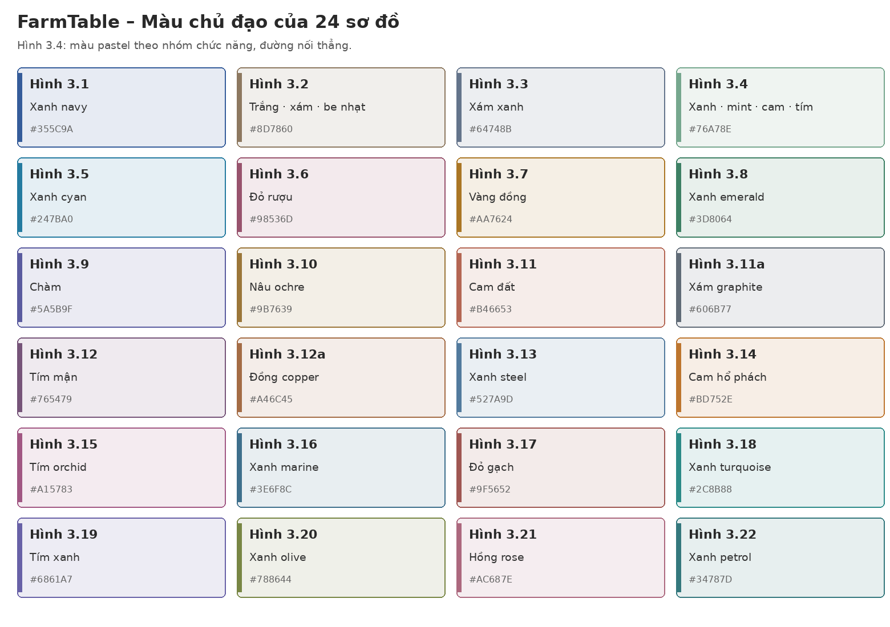
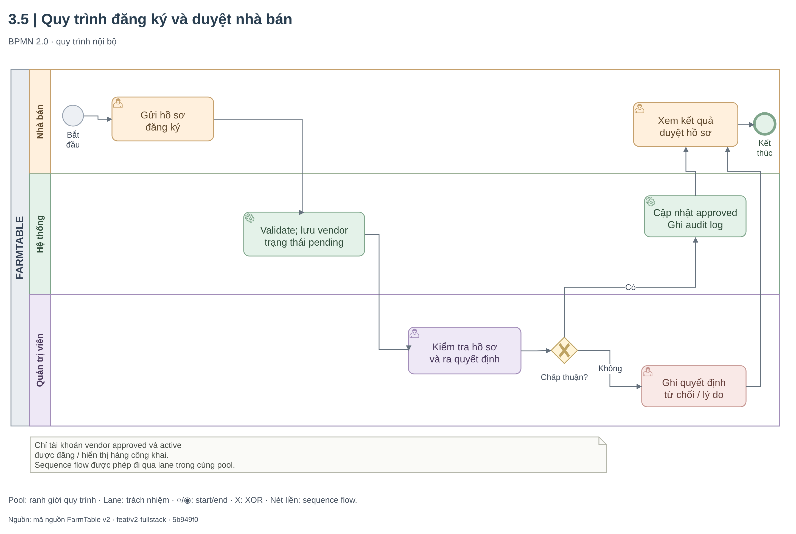

# FarmTable – Chương 3: Phương pháp thực hiện

Người viết: Vũ Thu Hà. Bản Word/PDF đã chỉnh lại văn phong theo các chương đã viết trong outline, dùng cỡ chữ 13 và bổ sung liên kết Draw.io cạnh từng chú thích hình. Bản PDF hiện có 37 trang, 24 hình và 16 bảng.

## Tải tài liệu

- **[Tệp Draw.io nhiều trang, chỉnh sửa được](So_do_BA/FarmTable_Chuong3_BA.drawio?raw=true)**
- **[PDF sơ đồ khổ A3, 24 trang để đọc/in chi tiết](So_do_BA/FarmTable_So_do_BA_A3.pdf?raw=true)**
- [Word sơ đồ khổ A3](So_do_BA/FarmTable_So_do_BA_A3.docx?raw=true)
- [Tải trọn bộ Draw.io, PNG, SVG và bản A3](So_do_va_anh_Chuong3.zip?raw=true)
- [Chương 3 – Word đã chỉnh văn phong, cỡ chữ 13](FarmTable_Chuong3.docx?raw=true)
- [Chương 3 – PDF đã chỉnh văn phong, cỡ chữ 13](FarmTable_Chuong3.pdf?raw=true)

Để sửa: tải tệp `.drawio`, mở https://app.diagrams.net/ → **File → Open From → Device**. Đổi trang bằng thanh tab phía dưới. Mỗi khối, nhãn và đầu nối là đối tượng gốc, không phải một ảnh nền. Đọc [hướng dẫn và danh mục đầy đủ](So_do_BA/README_BA.md).

Nếu GitHub không xem trước được, chọn **Download raw file**. Bản A3 là bản chi tiết để đọc các trường ERD và nhãn dài; hình trong chương được thu nhỏ để giữ nhịp nội dung.

## Bản chỉnh văn phong và định dạng

Nội dung được viết lại theo mạch trình bày của Chương 1, 4, 5 và 6 trong tài liệu Hà cung cấp: giải thích nhu cầu, cách nhóm thực hiện và ý nghĩa của lựa chọn. Các đoạn chuyển ý được bổ sung; các câu rời theo kiểu ghi chú kỹ thuật được chuyển thành đoạn văn. Cấu trúc 3.1–3.8 và nội dung nghiệp vụ được giữ lại.

- Chữ cỡ **13** ở nội dung, đề mục, bảng, mã minh họa, chú thích và số trang.
- Cả **24 chú thích hình** có phần **(link)** màu xanh, gạch chân, mở bản gốc bằng Draw.io; bản PDF cũng giữ các liên kết này.
- Các liên kết trỏ tới phiên bản sơ đồ đã chốt màu và sửa đường nối, giúp nội dung trong hình khớp với bản mở để chỉnh sửa.
- Bộ sơ đồ và các bản A3 vẫn được giữ trong thư mục `So_do_BA`.

Xem [ghi chú biên tập và phạm vi kiểm tra](GHI_CHU_BIEN_TAP.md).

## Màu và đường nối đã cập nhật

Mỗi hình dùng một tông màu chủ đạo riêng; giữ nền pastel và chữ tối. Đã sắp lại các đường hồi tiếp, đường lỗi, nhánh XOR và nhãn sự kiện/gateway bị đè. Đầu–cuối nghiệp vụ, nhãn và ký pháp được đối chiếu với bản trước.

Xem [chi tiết chỉnh đường nối](So_do_BA/CAP_NHAT_MAU_VA_DUONG_NOI.md).

## Bộ hình vẽ lại

24 trang gồm 22 hình theo outline, ERD hỗ trợ (3.12a) và wireframe (3.11a). Dùng UML Use Case, Activity, Sequence, State Machine; BPMN 2.0 với pool/lane, XOR và timer boundary; DFD Yourdon–DeMarco; Logical ERD Crow’s Foot. Các hình còn lại dùng flowchart, pipeline hoặc sitemap phù hợp mục đích.

## Nguồn và kiểm tra

Đối chiếu mã nguồn `lini1907/Web_Project`, nhánh `feat/v2-fullstack`, commit `5b949f0a0b575308266e49af7b5d52604e8daf9d`. Bộ hình đã mở/xuất SVG bằng trình biên tập Draw.io cục bộ; kiểm tra đầu nối, pool boundary và ký pháp theo từng loại hình. Xem ảnh mở trong Draw.io ở `So_do_BA/kiem_tra_drawio/`.

Frontend đã build thành công. Bộ kiểm thử API cần MongoDB chưa được xác minh trong phiên soạn vì môi trường chặn tải binary MongoDB. Các mã TC dẫn theo outline không được hiểu là kết quả vừa chạy đạt.
