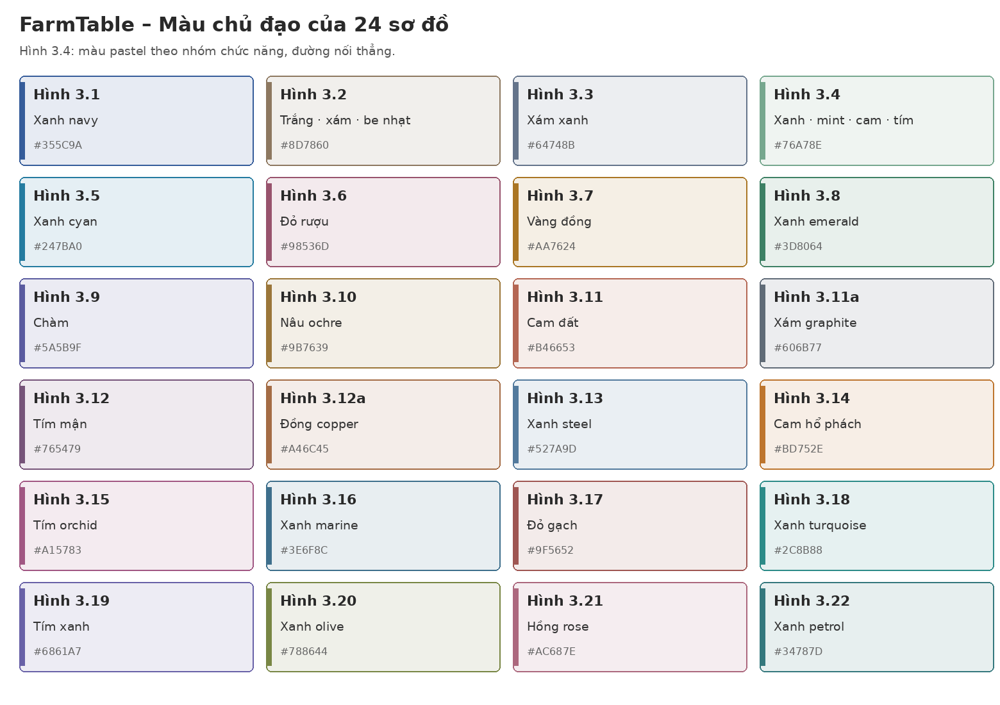

# FarmTable – Bộ sơ đồ chương 3, bản vẽ lại

Bộ gồm **24 trang Draw.io**: 22 hình theo outline, ERD dữ liệu hỗ trợ (3.12a) và wireframe (3.11a). Mỗi phần tử là shape, nhãn hoặc connector riêng, có thể sửa trong Draw.io. Tệp đã được mở và xuất SVG bằng trình biên tập Draw.io chạy cục bộ từ mã nguồn chính thức jgraph/drawio. Không dùng ảnh nền để giả lập sơ đồ chỉnh sửa được.

## Tải và chỉnh sửa

1. Tải `FarmTable_Chuong3_BA.drawio`.
2. Mở https://app.diagrams.net/ → **Device** → **Open Existing Diagram** (hoặc **File → Open From → Device**).
3. Chọn trang ở thanh tab phía dưới. Bấm hai lần vào nhãn để sửa; kéo đầu connector để thay quan hệ.
4. Nếu cần từng hình riêng, lấy trong `drawio/`. Ảnh chèn báo cáo có ở `png/`, bản vector ở `svg/`.

**Bản A3:** `FarmTable_So_do_BA_A3.pdf` và `.docx` có 24 trang khổ A3 ngang, một sơ đồ/trang. Nên dùng bản này để đọc/in chi tiết. Chương 3 giữ hình tổng quan trong luồng nội dung; khi đọc chữ nhỏ như trường ERD, xem bản A3.

## Màu chủ đạo theo từng hình

Mỗi hình có một tông riêng theo yêu cầu. Nền pastel và chữ tối để dễ đọc/in. Màu không thay thế ký pháp: gateway, actor, dữ liệu, cardinality và hướng luồng vẫn nhận diện qua hình dạng/nhãn.

| Hình | Tông chủ đạo | Màu gốc |
|---|---|---|
| 3.1 | Xanh navy | `#355C9A` |
| 3.2 | Trung tính: trắng, xám và be nhạt | `#8D7860` |
| 3.3 | Xám xanh | `#64748B` |
| 3.4 | Pastel xanh, mint, cam và tím | `#76A78E` |
| 3.5 | Xanh cyan | `#247BA0` |
| 3.6 | Đỏ rượu | `#98536D` |
| 3.7 | Vàng đồng | `#AA7624` |
| 3.8 | Xanh emerald | `#3D8064` |
| 3.9 | Chàm | `#5A5B9F` |
| 3.10 | Nâu ochre | `#9B7639` |
| 3.11 | Cam đất | `#B46653` |
| 3.11a | Xám graphite | `#606B77` |
| 3.12 | Tím mận | `#765479` |
| 3.12a | Đồng copper | `#A46C45` |
| 3.13 | Xanh steel | `#527A9D` |
| 3.14 | Cam hổ phách | `#BD752E` |
| 3.15 | Tím orchid | `#A15783` |
| 3.16 | Xanh marine | `#3E6F8C` |
| 3.17 | Đỏ gạch | `#9F5652` |
| 3.18 | Xanh turquoise | `#2C8B88` |
| 3.19 | Tím xanh | `#6861A7` |
| 3.20 | Xanh olive | `#788644` |
| 3.21 | Hồng rose | `#AC687E` |
| 3.22 | Xanh petrol | `#34787D` |

Đã rà lại đường hồi tiếp, các nhánh XOR, đường lỗi, vị trí nhãn gateway/sự kiện và các đường đi qua ghi chú. Chi tiết tại `CAP_NHAT_MAU_VA_DUONG_NOI.md`.

## Quy ước dùng trong bộ hình

| Loại hình | Quy ước |
|---|---|
| UML Use Case | Actor ở ngoài system boundary; use case là elip; association không có mũi tên; include là nét đứt hướng tới use case được bao gồm. Đăng nhập dùng như tiền điều kiện, không include máy móc mọi chức năng. |
| BPMN 2.0 | Pool/lane theo trách nhiệm; sự kiện start/intermediate/end; task user/service; gateway XOR có X. Sequence flow không vượt pool; message flow nét đứt giữa các pool. Timer boundary mô tả timeout ML. |
| DFD Yourdon–DeMarco | Tác nhân ngoài hình chữ nhật, tiến trình đánh số, kho dữ liệu hai đường ngang; tên luồng là dữ liệu. Mức 0 dùng quy ước sơ đồ ngữ cảnh; mức 1 là trích phân hệ người mua, không phải toàn bộ hệ thống. |
| Logical ERD Crow’s Foot | Thực thể, thuộc tính chính, PK/UQ/REF và cardinality. Với MongoDB, REF là tham chiếu logic; dữ liệu nhúng được ghi rõ, không biến thành collection độc lập. |
| UML Sequence | Lifeline, activation và thứ tự lời gọi/phản hồi; chỉ vẽ luồng đăng nhập thành công. |
| UML State Machine | Initial/final state; sự kiện [guard] / action. Phần đơn và thanh toán tách vòng đời. |
| Flowchart / pipeline / sitemap | Dùng đúng mục đích, không gắn nhãn BPMN cho mọi hình hộp/mũi tên. |

## Danh mục

| Hình | Tên | Ký pháp |
|---|---|---|
| 3.1 | [Quy trình nâng cấp FarmTable](drawio/Hinh_3_1.drawio) | Quy trình phát triển |
| 3.2 | [Kiến trúc tổng thể hệ thống FarmTable](drawio/Hinh_3_2.drawio) | UML component / kiến trúc logic |
| 3.3 | [Luồng xử lý yêu cầu qua middleware](drawio/Hinh_3_3.drawio) | UML activity diagram |
| 3.4 | [Sơ đồ use case tổng quát](drawio/Hinh_3_4.drawio) | UML use case diagram |
| 3.5 | [Quy trình đăng ký và duyệt nhà bán](drawio/Hinh_3_5.drawio) | BPMN 2.0 · quy trình nội bộ |
| 3.6 | [Quy trình đặt hàng và thanh toán](drawio/Hinh_3_6.drawio) | BPMN 2.0 · collaboration |
| 3.7 | [Vòng đời chiến dịch mua chung](drawio/Hinh_3_7.drawio) | BPMN 2.0 · quy trình tổng quan |
| 3.8 | [Quy trình gợi ý có phương án dự phòng](drawio/Hinh_3_8.drawio) | BPMN 2.0 · timeout boundary event |
| 3.9 | [DFD mức 0 – sơ đồ ngữ cảnh](drawio/Hinh_3_9.drawio) | DFD · quy ước Yourdon–DeMarco |
| 3.10 | [DFD mức 1 phân hệ người mua](drawio/Hinh_3_10.drawio) | DFD · Yourdon–DeMarco |
| 3.11 | [Sơ đồ trang của hệ thống](drawio/Hinh_3_11.drawio) | Information architecture / sitemap |
| 3.11a | [Wireframe catalog desktop / mobile](drawio/Hinh_3_11a.drawio) | Low-fidelity wireframe |
| 3.12 | [ERD lõi giao dịch](drawio/Hinh_3_12.drawio) | Logical ERD · Crow’s Foot |
| 3.12a | [ERD dữ liệu hỗ trợ và vận hành](drawio/Hinh_3_12a.drawio) | Logical ERD · phần bổ sung cho Hình 3.12 |
| 3.13 | [Đăng nhập, phiên và CSRF](drawio/Hinh_3_13.drawio) | UML sequence diagram |
| 3.14 | [Tính giá và kiểm tra hàng giải cứu](drawio/Hinh_3_14.drawio) | Lưu đồ nghiệp vụ |
| 3.15 | [Mua Mystery Box trong transaction](drawio/Hinh_3_15.drawio) | Lưu đồ nghiệp vụ |
| 3.16 | [Trạng thái chiến dịch mua chung](drawio/Hinh_3_16.drawio) | UML state machine |
| 3.17 | [Worker đóng chiến dịch mua chung](drawio/Hinh_3_17.drawio) | Lưu đồ nghiệp vụ |
| 3.18 | [Lưu đồ đặt hàng](drawio/Hinh_3_18.drawio) | Lưu đồ nghiệp vụ |
| 3.19 | [Trạng thái phần đơn và thanh toán](drawio/Hinh_3_19.drawio) | UML state machine |
| 3.20 | [Huấn luyện và phục vụ mô hình gợi ý](drawio/Hinh_3_20.drawio) | Data pipeline / model serving |
| 3.21 | [Gợi ý có phương án dự phòng](drawio/Hinh_3_21.drawio) | Lưu đồ nghiệp vụ |
| 3.22 | [Vòng lặp function calling của chatbot](drawio/Hinh_3_22.drawio) | Lưu đồ nghiệp vụ |

## Nghiệp vụ đã đối chiếu

- Giá Rescue do server tính; giảm 30–50%; kiểm lại hạn và kho khi mua.
- Mystery Box ẩn thành phần trong DTO công khai; mua trong transaction, thiếu một nguyên liệu thì rollback.
- Group Buy giữ chỗ khi join, không tạo đơn ngay; đạt maxQty đóng sớm, chỉ đạt targetQty thì chờ deadline. Membership chưa có orderId mới được sinh đơn khi chốt; retry không sinh lại đơn cũ.
- Đơn nhiều vendor có `parts[]`; trạng thái giao hàng không đi lùi; hủy hoàn kho một lần. `refund_pending` không phải đã hoàn tiền thật.
- Callback cổng thanh toán kiểm HMAC và số tiền; không dùng kết quả hiển thị trình duyệt làm chứng cứ thanh toán.
- ML có timeout 1.500 ms và fallback; chatbot chỉ đọc đơn của chính người mua. Mã hiện tại `round <= 5` có thể gọi model tối đa 6 lượt, không mô tả thành đúng 5 lượt.

Nguồn mã: lini1907/Web_Project, nhánh feat/v2-fullstack, commit `5b949f0a0b575308266e49af7b5d52604e8daf9d`; outline và thông tin dự án Hà cung cấp. Đây là mô hình hóa và kiểm tra ký pháp/đối chiếu mã, không phải chứng nhận tuân thủ BPMN của một công cụ phân tích thực thi. Bộ API test cần MongoDB vẫn chưa được xác minh trong phiên soạn.
